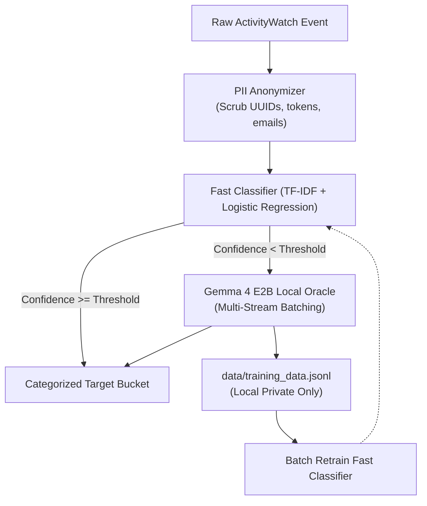

# ActivityWatch Classifier Training Data

This directory contains the training dataset for the Fast Classifier (logistic regression active learning model).

## Privacy Policy
> [!IMPORTANT]
> **Your actual training dataset (`data/training_data.jsonl`) is strictly private, local-only, and permanently excluded from Git in `.gitignore`.**
> 
> Because window titles and URLs may occasionally contain sensitive names, project paths, or private context, training samples are never tracked in version control.

---

## Example Dataset (`training_data.example.jsonl`)

An example template dataset is provided in [`training_data.example.jsonl`](training_data.example.jsonl). 

If you are setting up a fresh installation without existing history, you can initialize your dataset from the template:

```bash
cp data/training_data.example.jsonl data/training_data.jsonl
```

---

## Dataset Schema (JSON Lines)

Each line in `training_data.jsonl` is a standalone JSON object representing one categorized activity:

| Field | Type | Description | Example |
| :--- | :--- | :--- | :--- |
| `feature_text` | `string` | PII-sanitized combined representation of app, domain, path, title, and URL | `"app:code domain: root_domain: path: title:main.py - vscode url:"` |
| `category` | `string` | Top-level taxonomy category | `"Development"` |
| `subcategory` | `string` | Fine-grained activity subcategory | `"Coding & IDE"` |
| `full_category` | `string` | Hierarchical category path | `"Development > Coding & IDE"` |
| `category_hierarchy` | `list[str]` | Hierarchical category array | `["Development", "Coding & IDE"]` |
| `source` | `string` | Label source: `seed`, `gemma_e2b`, or `human_correction` | `"gemma_e2b"` |
| `timestamp` | `string` | ISO-8601 creation timestamp | `"2026-11-01T10:00:00Z"` |

### Example JSON Record
```json
{
  "feature_text": "app:firefox domain:github.com root_domain:github.com path:pull title:pull request #42 · activitywatch/activitywatch url:https://github.com/activitywatch/activitywatch/pull/42",
  "category": "Development",
  "subcategory": "Git & Code Review",
  "full_category": "Development > Git & Code Review",
  "category_hierarchy": ["Development", "Git & Code Review"],
  "source": "gemma_e2b",
  "timestamp": "2026-11-01T10:20:00Z"
}
```

---

## Active Learning Workflow


